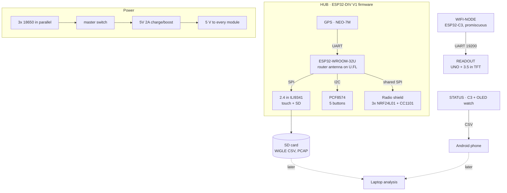

# War-rig-phantom
### *A Portable OPSEC/OSINT Recon Deck*

**A full ESP32-DIV multi-tool handheld (WiFi / BLE / 2.4 GHz / sub-GHz) plus standalone recon modules, with GPS-tagged logging**

**[Build page](https://lincalibur.github.io/War-rig-phantom/)**: boards, wiring diagram, parts checklist and build order

---

## Overview

**War-rig-phantom** is a portable wireless multi-tool and recon kit made of separate modules. Each module has its own screen and job:

- **`HUB`:** a full ESP32-DIV V1 handheld on an ESP32-WROOM-32U with a router antenna and a radio shield (3× NRF24L01 + CC1101). It has a 2.4" touch TFT, buttons and a NEO-7M GPS. It runs the complete ESP32-DIV toolkit — WiFi scan/deauth/evil-portal/packet-monitor, BLE scan/spoof/jam, 2.4 GHz (NRF24) and sub-GHz (CC1101) tools, deauth detection, and GPS wardriving logged to SD as WiGLE CSV.
- **`WIFI-NODE` → `READOUT`:** an ESP32-C3 WiFi sniffer streams to an Arduino UNO with a 3.5" screen. It sorts clients by how long they've been nearby, which flags devices that keep following you.
- **`STATUS`:** a removable ESP32-C3 + OLED watch that logs GPS and WiFi scans to a phone.

The modules share one 3x 18650 pack and a 5 V boost module. Later, all the logs go to a laptop for analysis.

> **Scope & Ethics**
> The HUB runs the full ESP32-DIV firmware, which **includes active, transmitting attack tools** (deauth, beacon/probe flood, evil portal, BLE spoof/jam, NRF24 and CC1101 jam/replay).
> - Use them **only** against hardware you own and control — the project's test laptop and spare router, on an isolated bench.
> - Never transmit against networks, devices or people you don't own. Deauth and jamming are illegal in most jurisdictions when aimed at others, and the radios interfere with anyone nearby.
> - The passive recon modules (`WIFI-NODE`/`READOUT`, `STATUS`) only listen and log.
>
> This is an authorized-testing and learning platform. You are responsible for staying within the law.

## Architecture

Wiring for the `HUB` is on the build page and in three drawings: [`docs/wiring-overview.svg`](docs/wiring-overview.svg) (the ESP32 + touchscreen assembly and the protoboard, joined by the 6-wire J1 cable), [`docs/wiring.svg`](docs/wiring.svg) (ESP32 + touchscreen) and [`docs/wiring-protoboard.svg`](docs/wiring-protoboard.svg) (GPS, PCF8574 and buttons). Board names are defined in [`docs/hardware-layout.md`](docs/hardware-layout.md#board-names).

## Repository

| Path | What's in it |
|---|---|
| [`docs/OVERVIEW.md`](docs/OVERVIEW.md) | **Start here.** Goals, decisions, capabilities, status and next steps |
| [`docs/hardware-layout.md`](docs/hardware-layout.md) | The current build: board names, HUB pins, power, case |
| [`cad/wiring/`](cad/wiring/) | Script that draws the HUB wiring diagrams |
| [`docs/build-page.html`](docs/build-page.html) | Source of the build page (deployed by `.github/workflows/pages.yml`) |
| [`v2/`](v2/README.md) | Firmware: the working `WIFI-NODE` + `READOUT` sketches, plus shelved hub and node code |
| [`docs/proto-readout-wiring.html`](docs/proto-readout-wiring.html) | `WIFI-NODE` → `READOUT` wiring |
| [`docs/BOARD-BLE-SCAN-ESP32-1732S019.md`](docs/BOARD-BLE-SCAN-ESP32-1732S019.md) | Spec for the `BLE-SCAN` board (on hand, not in this build) |
| [`cad/case_filler/`](cad/case_filler/), [`docs/PCB-BOM-AND-NETLIST.md`](docs/PCB-BOM-AND-NETLIST.md), [`docs/esp32-hub-board.html`](docs/esp32-hub-board.html), [`KiCad Design/`](KiCad%20Design/) | Shelved designs: Pi 5 clamshell filler and single PCB |
| [`docs/debian-esp32-server-guide.md`](docs/debian-esp32-server-guide.md) | Remote compile/flash station over SSH (the server is being rebuilt) |

The `HUB` runs cifertech's [ESP32-DIV](https://github.com/cifertech/ESP32-DIV) firmware, v1 target, unmodified — flashed from the stock `ESP32-DIV-v1-v1.7.2.bin`. The radio shield's NRF24/CC1101 pins are fixed by the firmware's `shared.h`, so no source changes are needed; wire to the pins in [`docs/hardware-layout.md`](docs/hardware-layout.md#radio-shield-nrf24--cc1101).

The v1 build (ESP-NOW C3 nodes and an ESP32-1732S019 hub) was removed from the tree. Recover it with `git checkout v1-espnow-archive`.

## Status

| Area | State |
|---|---|
| HUB parts | 🟨 ordered from nde3d 2026-11-02, waiting for collection |
| HUB wiring and firmware | 🟨 wiring drawn from the firmware pins; prebuilt v1.7.0 ready to flash |
| WIFI-NODE + READOUT | ✅ working on the bench |
| STATUS watch | ✅ working |
| Power system | ⬜ ordered; bench test first |
| Case layout | ⬜ to be redrawn for these parts |
| Laptop analysis | ⬜ planned |

## License

See [LICENSE](LICENSE).
