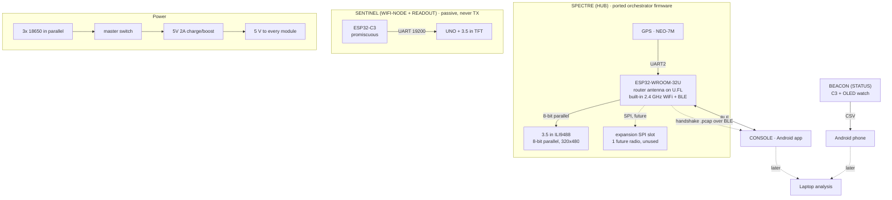

# War-rig-phantom
### *A Portable OPSEC/OSINT Recon Deck*

**A full ESP32-DIV multi-tool handheld (WiFi / BLE / 2.4 GHz / sub-GHz) plus standalone recon modules, with GPS-tagged logging**

**[Build page](https://lincalibur.github.io/War-rig-phantom/)**: boards, wiring diagram, parts checklist and build order

---

## Overview

**War-rig-phantom** is a portable wireless multi-tool and recon kit made of separate modules. Each module has its own screen and job:

- **`SPECTRE`** (role: `HUB`): the active handheld — an ESP32-WROOM-32U with a router antenna on U.FL, a **3.5" ILI9488 8-bit parallel TFT** and a NEO-7M GPS. It runs the ported **CyberDeck orchestrator** (a Ghost-ESP-style toolkit), driven from the `CONSOLE` phone app over BLE, on the ESP32's **built-in 2.4 GHz radio**: WiFi scan/deauth/evil-portal/packet-monitor/wardrive, BLE scan/spam, handshake → `.pcap` streamed to the phone, and HID. No radio shield, no buttons, no SD; one expansion SPI slot is reserved for a single future CC1101/NRF24.
- **`SENTINEL`** (roles: `WIFI-NODE` + `READOUT`): an ESP32-C3 WiFi/BLE sniffer streams over a one-way 19200 UART to an Arduino UNO with a 3.5" screen. It's the passive, always-on watcher — flags trackers, tails and attacks, and never transmits.
- **`BEACON`** (role: `STATUS`): a removable ESP32-C3 + OLED watch that logs GPS and WiFi scans to a phone.
- **`CONSOLE`:** the Android (Flutter) app that drives `SPECTRE` over BLE.

The modules share one 18650 pack and a 5 V boost module. Later, all the logs go to a laptop for analysis.

> **Scope & Ethics**
> `SPECTRE`'s orchestrator **includes active, transmitting tools** (WiFi deauth, beacon/probe/karma flood, evil portal, BLE spam, a best-effort BLE adv-flood "jammer", and HID) — all on the ESP32's built-in 2.4 GHz radio.
> - Use them **only** against hardware you own and control — the project's test laptop and spare router, on an isolated bench.
> - Never transmit against networks, devices or people you don't own. Deauth is illegal in most jurisdictions when aimed at others, and the radio interferes with anyone nearby.
> - The passive modules (`SENTINEL`, `BEACON`) only listen and log.
>
> This is an authorized-testing and learning platform. You are responsible for staying within the law.

## Architecture

SPECTRE wiring is documented in [`docs/hardware-layout.md`](docs/hardware-layout.md#spectre-pins) and [`hardware/spectre-pcb/PINOUT.md`](hardware/spectre-pcb/PINOUT.md). (The drawing [`docs/wiring.svg`](docs/wiring.svg) predates the 2026-11-15 pin remap and is stale.) Board names are defined in [`docs/hardware-layout.md`](docs/hardware-layout.md#module-names).

## Repository

| Path | What's in it |
|---|---|
| [`docs/OVERVIEW.md`](docs/OVERVIEW.md) | **Start here.** Goals, decisions, capabilities, status and next steps |
| [`docs/hardware-layout.md`](docs/hardware-layout.md) | The current build: board names, HUB pins, power, case |
| [`docs/case-planner.html`](docs/case-planner.html) | 3D case layout planner: size parts, drag them around the clamshell, check fit, export an OpenSCAD filler (live on the Pages site) |
| [`cad/wiring/`](cad/wiring/) | Script that draws the HUB wiring diagrams |
| [`docs/build-page.html`](docs/build-page.html) | Source of the build page (deployed by `.github/workflows/pages.yml`) |
| [`spectre/v1/`](spectre/v1/) | **SPECTRE firmware** — the orchestrator on one ESP32-WROOM-32U (see [`STATUS.md`](spectre/v1/STATUS.md)) |
| [`sentinel/v1/`](sentinel/v1/) | **SENTINEL firmware** — the passive watcher (ESP32-C3 + UNO pair) |
| [`hardware/spectre-pcb/`](hardware/spectre-pcb/) | SPECTRE custom carrier PCB (KiCad), on branch `spectre-pcb` |
| [`app/`](app/) | **CONSOLE** — the Android (Flutter) app that drives SPECTRE over BLE |
| [`docs/proto-readout-wiring.html`](docs/proto-readout-wiring.html) | SENTINEL C3 → UNO readout wiring |
| [`docs/BOARD-BLE-SCAN-ESP32-1732S019.md`](docs/BOARD-BLE-SCAN-ESP32-1732S019.md) | Spec for the `RELAY`/`BLE-SCAN` board (on hand, not in this build) |
| *(removed — see git tag `pre-cleanup-2026-11-20`)* | Shelved designs: single-PCB BOM, ESP32 hub-board page, KiCad CyberDeckv1, Pi 5 clamshell filler. Cut from the tree 2026-11-20, recoverable from the tag and git history |
| [`docs/debian-esp32-server-guide.md`](docs/debian-esp32-server-guide.md) | Remote compile/flash station over SSH (the server is being rebuilt) |

The `HUB` role is filled by **SPECTRE**, which runs the CyberDeck **orchestrator** firmware ported onto one ESP32-WROOM-32U ([`spectre/v1/`](spectre/v1/)) — **not** stock ESP32-DIV. cifertech's [ESP32-DIV](https://github.com/cifertech/ESP32-DIV) was only a reference example for "what's possible," not the codebase. The current, hardware-verified state (display = ILI9488 3.5" parallel, pinout, radios) lives in [`spectre/v1/STATUS.md`](spectre/v1/STATUS.md); the older stock-ESP32-DIV radio-shield spec in [`docs/hardware-layout.md`](docs/hardware-layout.md) predates the port and is still being reconciled (see the note at the top of that file).

The v1 build (ESP-NOW C3 nodes and an ESP32-1732S019 hub) was removed from the tree. Recover it with `git checkout v1-espnow-archive`.

## Status

| Area | State |
|---|---|
| HUB parts | 🟨 ordered from nde3d 2026-11-02, waiting for collection |
| HUB wiring and firmware | 🟨 wiring drawn from the firmware pins; prebuilt v1.7.0 ready to flash |
| WIFI-NODE + READOUT | ✅ working on the bench |
| STATUS watch | ✅ working |
| Power system | ⬜ ordered; bench test first |
| Case layout | ⬜ to be redrawn for these parts |
| Laptop analysis | ⬜ planned |

## License

See [LICENSE](LICENSE).
