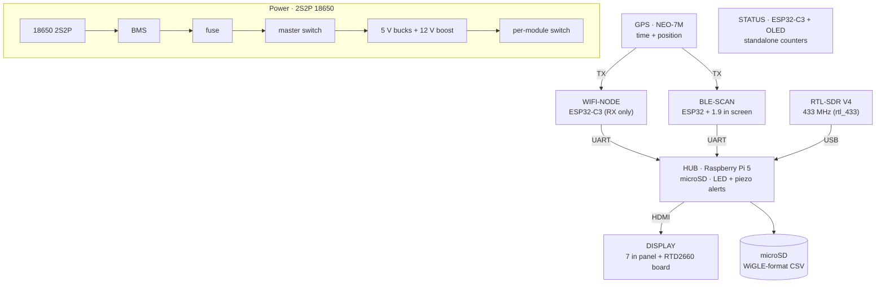

<div align="center">

# War-rig-phantom
### *A Portable OPSEC/OSINT Recon Deck*

**Passive WiFi, BLE and sub-GHz listening with GPS-tagged logging, in a 22 cm clamshell case**


**[Build page](https://lincalibur.github.io/War-rig-phantom/)**: boards, case layout, parts checklist and wiring

</div>

---

## Overview

**War-rig-phantom** is a portable counter-surveillance deck built into a 22 × 22 cm clamshell case. Two receive-only ESP32 nodes (WiFi and BLE) and an RTL-SDR for 433 MHz feed a Raspberry Pi 5 hub. It logs WiGLE-format CSV to microSD, flags devices that keep following you, and shows sightings on an offline map. A 7" panel fills the lid, and printed filler blocks hold every part. A GPS module feeds both nodes, so every sighting carries its own position and time. It runs from a 2S2P 18650 pack.

> **Scope & Ethics**
> Everything in this project is **passive listening and logging.**
> - No deauth transmission
> - No packet injection
> - No touching networks you don't own
>
> This is a recon and awareness tool, not an attack platform.

## Architecture



> The nodes **only ever receive** and report to the hub over wired UART — nothing in the deck transmits on the scanned bands. `STATUS` runs independently of the hub. Detailed pin-level view below:

```
  GPS (NEO-7M) TX --+--> WIFI-NODE  ESP32-C3 ---------------------UART--+
                    +--> BLE-SCAN   ESP32 + built-in 1.9" screen --UART--+
                                                                         v
                         HUB  Raspberry Pi 5: microSD, RTL-SDR on USB, LED + piezo alerts
                                                                         |  HDMI
                                                                         v
                         DISPLAY  7" panel + RTD2660 driver board

  STATUS  ESP32-C3 + OLED (standalone counters)
  2S2P 18650 -> BMS -> fuse -> master switch -> 5 V bucks + 12 V boost -> one switch per module
```

The nodes never transmit. They report to the hub over wired UART, which fixes the timing and near-field interference problems that sank the v1 ESP-NOW design. Board names (`HUB`, `DISPLAY`, `BLE-SCAN`, `WIFI-NODE`, `STATUS`) are defined in [`docs/hardware-layout.md`](docs/hardware-layout.md#board-names).

## Repository

| Path | What's in it |
|---|---|
| [`docs/OVERVIEW.md`](docs/OVERVIEW.md) | **Start here.** Goals, decisions, capabilities, status and next steps |
| [`docs/hardware-layout.md`](docs/hardware-layout.md) | The current build: board names, case layout and reasons |
| [`cad/case_filler/`](cad/case_filler/) | Printed filler: generator script and the 8 STL blocks |
| [`docs/BOARD-BLE-SCAN-ESP32-1732S019.md`](docs/BOARD-BLE-SCAN-ESP32-1732S019.md) | Spec for the `BLE-SCAN` board |
| [`docs/build-page.html`](docs/build-page.html) | Source of the build page (deployed by `.github/workflows/pages.yml`) |
| [`docs/PCB-BOM-AND-NETLIST.md`](docs/PCB-BOM-AND-NETLIST.md), [`docs/esp32-hub-board.html`](docs/esp32-hub-board.html), [`KiCad Design/`](KiCad%20Design/) | Shelved single-PCB design |
| [`v2/`](v2/README.md) | Firmware and bench prototypes (S3 hub and nodes written, not yet compiled; the Pi hub software is not written) |
| [`docs/debian-esp32-server-guide.md`](docs/debian-esp32-server-guide.md) | Remote compile/flash station over SSH |

The v1 build (ESP-NOW C3 nodes and an ESP32-1732S019 hub) was removed from the tree. Recover it with `git checkout v1-espnow-archive`.

## Status

| Area | State |
|---|---|
| Case layout and parts list | ✅ planned for the Pi 5 (2026-10-31); filler STLs generated, not test-fitted |
| Bench prototypes | ✅ WiFi readout working (C3 scanner to UNO + 3.5" TFT) |
| Power system | ⬜ parts to order; bench test first |
| Node firmware | 🟨 written for the old PCB; needs retargeting, then a first compile |
| Raspberry Pi 5 hub | ⬜ hardware planned; software planned in 6 stages (see the [build page](https://lincalibur.github.io/War-rig-phantom/#software)), not written |

## License

See [LICENSE](LICENSE).
