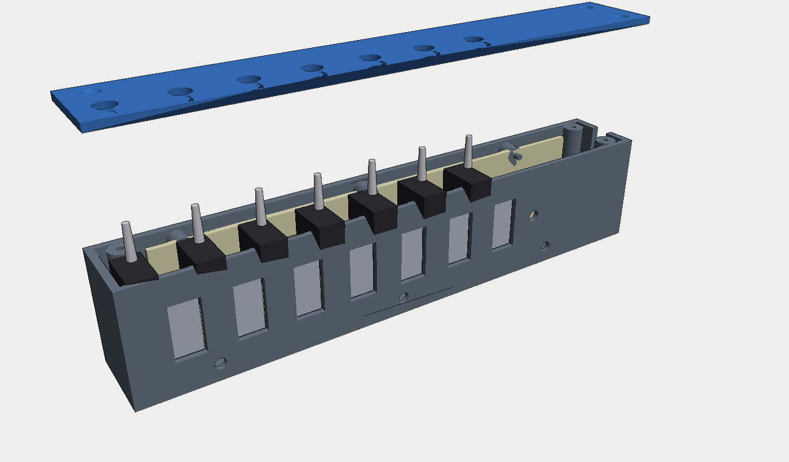
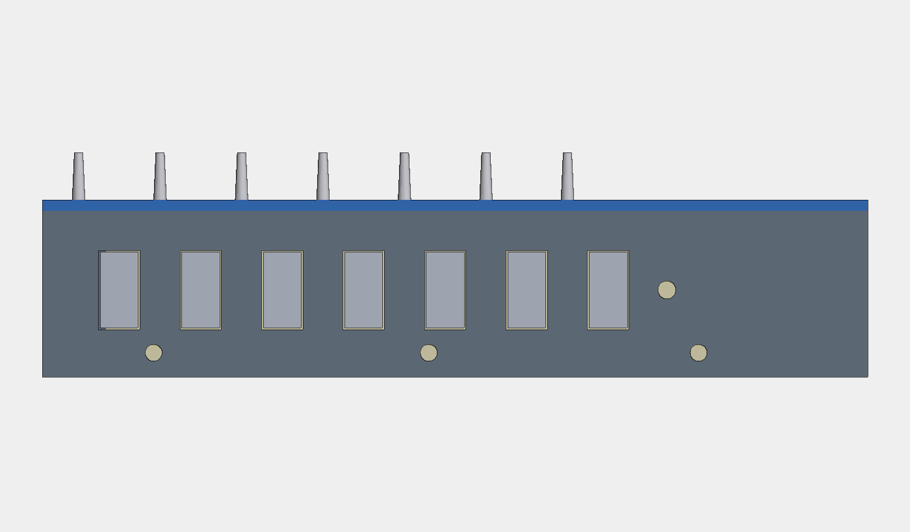
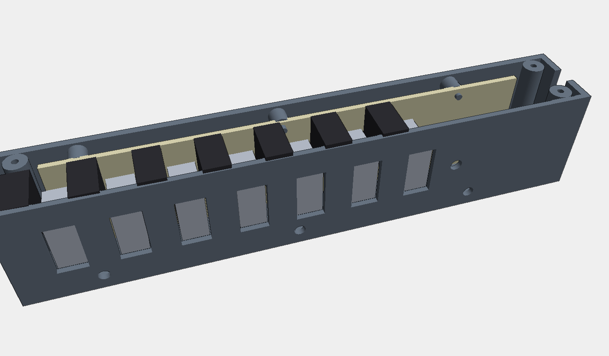

# USB hub switch case

A 3D-printed case for the bare 7-port USB hub board ([photo](../../hardware/Usb%20Hub.jpg)).
The board **stands on its long edge**. The USB ports point **forward** through the front wall, and
the toggle switches point **up** through the lid, one between each pair of ports. Each switch cuts its
port's 5 V, so you choose which module gets power. The case replaces the old black hub housing and
frees the router's strip along the hinge.







| Part | File | Print |
|---|---|---|
| Body: front wall with port openings + LED window, back-wall standoffs, screw bosses, cable slot | `out/usb_hub_body.stl` | Open side up. The standoffs are teardrop-shaped, so no supports |
| Lid: 7 switch holes with ON marks, 3 countersunk M2 holes, a rib that holds the board's top edge | `out/usb_hub_lid.stl` | Outer face down, no supports |

Outer size **156 long × 23 deep × 33.5 tall**. The levers add about 9 mm (≈ 42.5 mm total).

**Switch layout:** switch *n* sits on the port-1 side of port *n*. That puts switch 1 just past the
board's end and switches 2–7 in the gaps between ports, which keeps the LED clear. Each switch body
sits in front of the board, between the port shells. Levers flip front to back. The groove in front
of each hole marks ON.

**Assembly:**
1. Drop the board in and push it back onto the three top locating pins.
2. Screw the bottom three holes into the standoffs with M2 self-tappers. The driver goes in
   through the three small holes in the front wall.
3. Fit the switches to the lid and wire them (below).
4. Lower the lid. The switch bodies drop between the ports, and the lid rib catches the board's top edge.
5. Fit 3 × M2 countersunk screws.

```
python cad/usb_hub_case/usb_hub_case.py     # edit the numbers at the top, then rebuild the STLs
python cad/usb_hub_case/render_preview.py   # redraw out/preview*.png
```

The script refuses to build and lists the problem if a switch body hits a port, the board, a screw
boss or the LED path, or if the ports end too far behind the front wall for a plug to seat.

## Measure before printing

**Every number is an estimate** scaled off a hand-held photo. Measure these with calipers,
put them in the top of `usb_hub_case.py` and rebuild:

| Variable | What to measure | Estimate |
|---|---|---|
| `PCB_L`, `PCB_W` | Board length and width (not counting the port that hangs off the end) | 130 × 29 |
| `PORT_BX` | Each port's centre, measured from the port-1 end of the board | 2.5, 17.9 … 94.9 (15.4 pitch) |
| `PORT_SHELL_X`, `PORT_SHELL_Z` | A port's metal shell face-on: along the board × across it | 7.2 × 14.4 |
| `PORT_H` | Port face to the board's front surface | 13 |
| `BACK_PARTS` | Tallest thing on the back of the board (pins, solder, chips) | 3 |
| `HOLES` | The 6 mounting-hole centres (along, across) | pairs at 9 / 61 / 112 |
| `LED_BX` | LED centre from the port-1 end | 106 |
| `CABLE_BZ`, `END_PART_X` | Where the cable leaves; how far the black part overhangs the board end | 20; 3 |
| `SW_HOLE_D` | Your switch's bushing thread: M5 → 5.2, 1/4" → 6.5, 6 mm → 6.3 | 5.2 |
| `SW_BODY_X`, `SW_BODY_Y` | Switch body: narrow side (fits between ports) × long side (front to back) | 7 × 12.5 |
| `SW_DEPTH` | Body plus lugs below the panel | 11 |

Two numbers decide whether it works:
- **Gap between port shells** (pitch minus `PORT_SHELL_X`, about 8.2 mm). The switch body's narrow
  side has to fit in it, so a **sub-miniature toggle** (about 7 mm) is the right size.
- **Switch body length** (`SW_BODY_Y`). It sets how far back the board sits. At 12.5 mm the port faces
  end 1.4 mm behind the outer face, inside the 1.6 mm front wall, and plugs still seat. A longer
  body pushes the board further back. The script stops you if the plugs would no longer seat.

Also check what the **black part at the cable end** is (switch, jumper or connector). If you need
to reach it with the case closed, it needs an opening.

## Wiring: one switch per port

USB-A pin 1 is **VBUS (5 V)**. It's the outer pin of the 4-pin USB 2.0 row. On most cheap hubs every
port's pin 1 connects straight to the 5 V rail. To switch a port:

1. With the hub unplugged, confirm pin 1 of each port with a continuity tester against the **red** wire
   of the input cable.
2. Isolate each port's pin 1 from the rail: cut its trace next to the pin, or desolder the pin and
   bend it up clear of its pad. Check there's no continuity to the red wire any more.
3. Wire the switch **common** (middle lug) to the 5 V rail (red wire or any 5 V pad), and one
   **outer lug** to that port's pin 1. Use about 26 AWG wire. Each port draws under 0.5 A here.
   Leave enough slack to lift the lid off.
4. Test each port with a USB power meter before closing the lid.

Data lines and ground stay untouched, so the hub still works as a hub. Only 5 V is switched.

## Fitting it in the CyberDeck case

The case is **42.5 mm tall with the levers**, well past one 25 mm half. Whatever sits opposite it
when the deck closes must be under about 7 mm tall. The plugs also point forward: a straight USB-A
plug needs 30–40 mm of clear space in front of the hub. A 90° plug can turn down or sideways instead.
