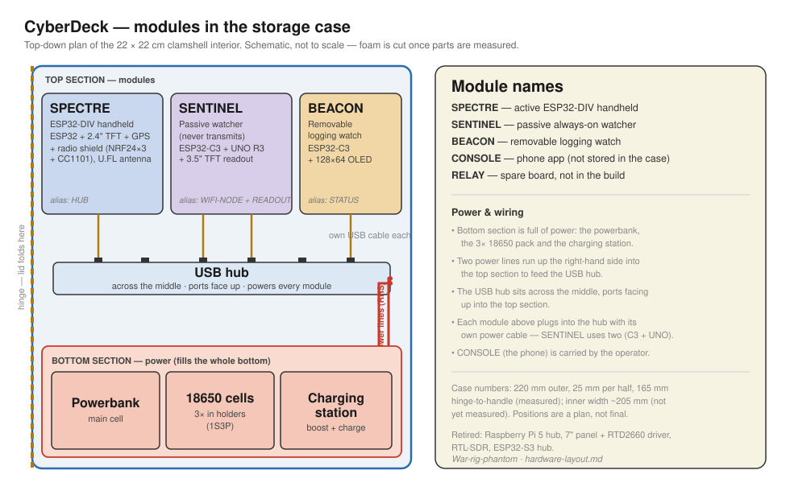
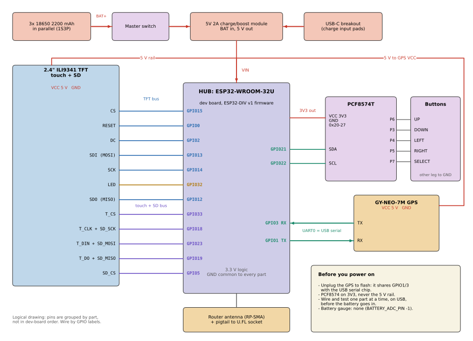

# Hardware layout

Physical layout for the cyberdeck: a portable, passive counter-surveillance station in a 22 × 22 cm clamshell case. A Raspberry Pi 5 4GB is the hub, a 7" panel fills the lid, and printed filler blocks hold everything.

The [build page](build-page.html) has the checked shopping list, pin table and build order. This page records the layout and the reasons behind it.

> **Update 2026-11-02:** the Pi 5 hub is dropped. The HUB is now an ESP32-WROOM-32U running ESP32-DIV v1 firmware (passive use only). The wiring drawing below shows that build. The case layout above and the rest of this page still describe the Pi 5 build.

> The case drawing and print files come from [`cad/case_filler/generate_filler.py`](../cad/case_filler/generate_filler.py); part sizes are nominal, so measure before ordering prints. The wiring drawing comes from [`cad/wiring/generate_wiring.py`](../cad/wiring/generate_wiring.py).

---

## Board names

| Name | Board | Job |
|---|---|---|
| `HUB` | Raspberry Pi 5 4GB + Active Cooler | Runs the hub software: collects node and SDR reports, logs to microSD, drives screen and alerts |
| `DISPLAY` | 7" SAT070AT50 panel + RTD2660 driver board | Main screen over HDMI |
| `BLE-SCAN` | ESP32-1732S019 | BLE trackers, own 1.9" screen. Spec: [`BOARD-BLE-SCAN-ESP32-1732S019.md`](BOARD-BLE-SCAN-ESP32-1732S019.md) |
| `WIFI-NODE` | ESP32-C3 + 2.4 GHz antenna | Headless WiFi promiscuous scanner |
| `STATUS` | ESP32-C3 + 128×64 OLED | Removable watch. Logs GPS and WiFi scans on its own and syncs to the hub when docked |
| (no name) | RTL-SDR Blog V4 | 433 MHz receive for `rtl_433`, on USB. Replaces the CC1101 (dropped 2026-11-02) |

The UNO + 3.5" `READOUT`, the ESP32-S3 and the microSD shield are retired from this build.

---

## Case

| Property | Value |
|---|---|
| Outer width | 220 mm |
| Inner width at rim | 205 mm assumed, **not measured** |
| Depth per half | 25 mm, measured (the earlier 35 mm figure was wrong) |
| Hinge wall to handle cut-out | 165 mm, measured |
| Hinge wall to front wall | 190 mm at the side walls, 210 mm beside the handle |

## Why the parts sit where they do

- **Pi in the base, panel in the lid.** The panel and a Pi with its cooler do not stack in 25 mm, so micro-HDMI crosses the hinge.
- **Pi under the deck.** It hangs from the deck with the cooler under a vent grille, on standoffs through four holes.
- **Radios in the lid.** The base has no spare bay. Behind the panel they are blocked, so pigtails run to the right wall. The RTL-SDR takes the bay the CC1101 had, and its USB cable crosses the hinge in place of the CC1101's SPI wires.
- **RTL-SDR away from the boost.** The 12 V boost shares the right bay, and its switching noise can swamp weak 433 MHz signals.
- **GPS patch facing the lid shell.** It is above the panel, facing outward when the lid is open.
- **Toggles sunk 5 mm.** They rise into a 7 mm recess in the lid, beside the panel rather than over it.
- **Fuse holder flat.** It is too long to stand in 25 mm, so it lies in a groove with the cap reachable.

## Open questions

- Inside width of the case, handle box and boss position
- JP2 readings, which decide whether the RTD2660 board can drive the panel
- Panel thickness (`PANEL_RECESS`) and its FPC position
- Holder, toggle, XL4015 and driver-board sizes
- Display draw at 12 V, against the MT3608's 1 A continuous rating
- Whether the hinge bundle fits the notch and flexes freely
- Pi hub software: planned in six stages on the [build page](build-page.html#software), not written yet
- Whether the RTL-SDR, buck, boost and WIFI-NODE all fit the right lid bay together
