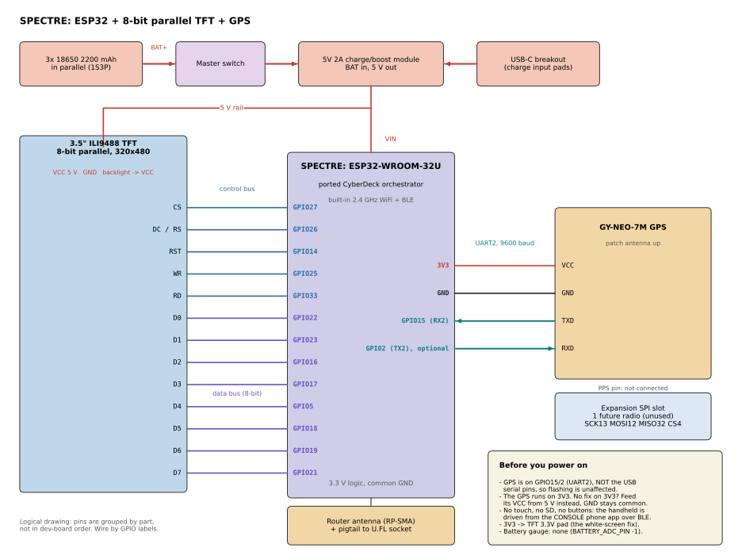
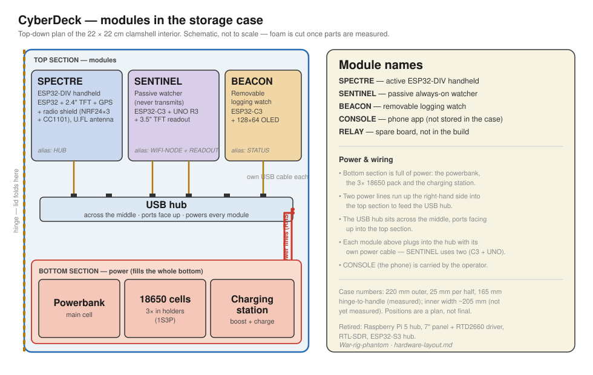

# Hardware layout

> The SPECTRE sections were rewritten 2026-11-21 to match the hardware-verified build in
> [`../spectre/v1/STATUS.md`](../spectre/v1/STATUS.md) and the carrier pinout in
> [`../hardware/spectre-pcb/PINOUT.md`](../hardware/spectre-pcb/PINOUT.md). SPECTRE runs the **ported
> CyberDeck orchestrator** (`spectre/v1/`), **not** stock cifertech ESP32-DIV firmware — that was only
> a reference example. If a detail here and STATUS.md ever disagree, STATUS.md wins.

The current build, as of 2026-11-21. The cyberdeck is a kit of separate modules. Each module has a
**fixed proper name** (so references don't drift when a module's role changes) and its own screen and job:

- **SPECTRE** is the active, phone-driven handheld: one ESP32-WROOM-32U running the ported orchestrator firmware (`../spectre/v1/`) with a 3.5" parallel TFT and a GPS.
- **SENTINEL** is the passive, always-on watcher (an ESP32-C3 + UNO pair). See [`watcher-plan.md`](watcher-plan.md).
- **BEACON** is the removable logging watch.

One single-cell 18650 pack and a 5 V boost module power them all. Later, the logs go to a laptop for analysis.

The [build page](build-page.html) has the shopping list, wiring and build order. This page records the parts, power and reasons.



> ⚠️ **`wiring.svg` is stale** — it was generated from `cad/wiring/generate_wiring.py` using cifertech's old ESP32-DIV pins, before the 2026-11-15 SPECTRE-carrier remap. Use the **"SPECTRE pins"** table below and [`../hardware/spectre-pcb/PINOUT.md`](../hardware/spectre-pcb/PINOUT.md) instead until the drawing is regenerated. The GPS wires straight to the ESP32; there is no protoboard and no button matrix — the handheld is driven from the CONSOLE phone app over BLE.

**What SPECTRE does.** It runs the ported CyberDeck orchestrator — a Ghost-ESP-style toolkit on one ESP32-WROOM-32U, driven from the CONSOLE phone app over BLE. The modes use the ESP32's **built-in 2.4 GHz radio** (WiFi + BLE) only:

- **Passive:** WiFi scan (OUI vendor + encryption type), packet-monitor waterfall, BLE sniffer/tracking table, GPS satellite scan, live GPS-stamped wardrive, and handshake capture → base64 EAPOL streamed to the phone as a `.pcap`.
- **Active (TX):** WiFi deauth (target chosen in the app), beacon/probe/karma floods, evil portal, BLE spam, best-effort BLE adv-flood "jammer", and HID. These **transmit**.
- There is **no NRF24 or CC1101 radio in the firmware.** The "jammer" is a WiFi-based adv-flood, not a true PHY jammer. A real 2.4 GHz (NRF24) or sub-GHz (CC1101) radio is a **future** add-on via the single expansion SPI slot (see "Radios & expansion" below).

> **Authorized testing only.** The active tools transmit. Use them **only** against hardware you own and control — the project's own test laptop and spare router on an isolated bench. Do not transmit against networks, devices or people you don't own. Deauth is illegal in most jurisdictions when aimed at others.

---

## Module names

Each **name** is tied to the physical hardware and stays fixed; the **role** is what it currently does
and may change. (The old role-based labels `HUB`/`WIFI-NODE`/`READOUT`/`STATUS`/`BLE-SCAN` are kept as
aliases so older docs still make sense.)

| Name | Was | Board | Role now | Firmware |
|---|---|---|---|---|
| **SPECTRE** | `HUB` | ESP32-WROOM-32U dev board (U.FL antenna) + **3.5" ILI9488 8-bit parallel TFT, 320×480** (no SD, no touch wired) + NEO-7M GPS. Phone/BLE driven, no button matrix. One expansion SPI slot for a future radio | **Active, phone-driven power tool** running the ported orchestrator: WiFi scan/deauth/evil-portal/packet-monitor/wardrive, BLE scan/spam, handshake→pcap, HID — all on the ESP32's built-in 2.4 GHz radio. No NRF24/CC1101 in firmware yet | **ported CyberDeck orchestrator** (`spectre/v1/`), compiles ~34% flash / 22% RAM, display verified on hardware |
| **SENTINEL** | `WIFI-NODE` + `READOUT` | ESP32-C3 + Arduino UNO R3 / 3.5" TFT (soldered pair, one-way 19200 UART) | **Passive, always-on watcher** (never transmits): TRACKERS (following BLE tags), TAILS (persistent WiFi clients), ATTACKS (deauth floods, evil-twin APs). Alerts on screen + red LED. SENTINEL-C3 = brain, SENTINEL-TFT = screen | `sentinel/v1/{c3,uno}` (compile-verified 2026-11-13) |
| **BEACON** | `STATUS` | ESP32-C3 + 128×64 OLED | Removable logging watch. Logs GPS + WiFi scans and sends CSV to an Android phone; docks to the kit now and then | Working, on the watch |
| **CONSOLE** | — | Android phone app (Flutter) | Controls SPECTRE over BLE. `app/` | Built: `CyberDeck.apk` |
| **RELAY** | `BLE-SCAN` | ESP32-1732S019 (ESP32 + 1.9" screen) | Spare / utility, **not in this build**. Spec: [`BOARD-BLE-SCAN-ESP32-1732S019.md`](BOARD-BLE-SCAN-ESP32-1732S019.md) | — |

Retired: the Raspberry Pi 5 hub, the 7" panel and its RTD2660 driver, the RTL-SDR, and the ESP32-S3 hub. The modules no longer report to a central hub over UART. Each one works on its own.

---

## SPECTRE pins

The authoritative source is [`../spectre/v1/User_Setup_SPECTRE.h`](../spectre/v1/User_Setup_SPECTRE.h) (display) + [`../spectre/v1/spectre/spectre.ino`](../spectre/v1/spectre/spectre.ino) (GPS), and the carrier-connector map is [`../hardware/spectre-pcb/PINOUT.md`](../hardware/spectre-pcb/PINOUT.md). This is the optimized SPECTRE-carrier mapping (remapped 2026-11-15).

**Display — ILI9488, 3.5" 8-bit parallel, 320×480** (mcufriend-style Arduino-UNO-R3 shield footprint):

| Signal | ESP32 GPIO | | Signal | ESP32 GPIO |
|---|---|---|---|---|
| CS | 27 | | D0 | 22 |
| DC / RS | 26 | | D1 | 23 |
| RST | 14 | | D2 | 16 |
| WR | 25 | | D3 | 17 |
| RD | 33 | | D4 | 5 |
| | | | D5 | 18 |
| | | | D6 | 19 |
| | | | D7 | 21 |

**GPS — NEO-7M on UART2:**

| Signal | ESP32 GPIO |
|---|---|
| GPS TXD → ESP32 RX | 15 |
| ESP32 TX → GPS RXD | 2 |

- **3.3 V logic rail — the white-screen fix.** The shield doesn't self-regulate: wire **ESP32 3V3 → the shield's 3.3 V pad**, or the panel shows white. Backlight is hardwired to VCC (no PWM pin). The firmware calls `tft.invertDisplay(true)` after init (ILI9488 inverts by default).
- **No SD and no touch wired.** Display only. There is no battery gauge (`BATTERY_ADC_PIN = -1`).
- **No button matrix.** The PCF8574 and the five buttons were dropped; the handheld is driven from the CONSOLE phone app over BLE. There is no touch control either.
- **Strapping pins to watch** if boot/flash flakes: GPIO 5 (D4 — a glitch on a data line is harmless), GPIO 2 and 15 (GPS UART — IO2 is ESP32-driven and GPS TX idles high, both fine), GPIO 12 (expansion MOSI — see below), GPIO 0 (BOOT, left free).
- **GPS vs USB serial.** GPS is on IO15/IO2, *not* the USB-serial pins IO1/IO3, so flashing over USB is unaffected by the GPS.
- **Antenna.** A router antenna (RP-SMA) and pigtail go on the ESP32-WROOM-32U's U.FL socket. This is the only radio SPECTRE transmits on.

SENTINEL (the separate C3 + UNO watcher) uses a one-way 19200-baud UART between its two boards; that wiring is in [`proto-readout-wiring.html`](proto-readout-wiring.html) and [`watcher-plan.md`](watcher-plan.md), not here.

---

## Radios & expansion

SPECTRE's only working radio is the **ESP32-WROOM-32U's built-in 2.4 GHz** (WiFi + BLE), on the U.FL external antenna. **There is no NRF24 or CC1101 in the firmware** — every mode, including the "jammer," runs on the built-in radio (the BLE jammer is a best-effort adv-flood, not a true PHY jammer).

The carrier PCB brings out **one expansion SPI slot** (connector J8) for a *future* radio — it is **not wired or used by the firmware yet**:

| Signal | ESP32 GPIO | Notes |
|---|---|---|
| EXP_SCK | 13 | |
| EXP_MOSI | 12 | ⚠ strapping pin — **fit R1 (10k pulldown)** so a plugged-in radio can't hold IO12 high at boot (would select 1.8 V flash → no boot) |
| EXP_MISO | 32 | input-capable |
| EXP_CS0 | 4 | ⚠ IO4 low at boot — **add a 10k pull-up** |
| EXP_IN1–4 | 34, 35, 36, 39 | input-only (e.g. a radio's IRQ/GDO lines) |

- It's a VSPI-style bus via the GPIO matrix (~26 MHz cap — fine for a CC1101 or a single NRF24). It has room for **one** SPI radio at a time, **not** the full 3×NRF24 + CC1101 shield the earlier plan assumed: the 8-bit parallel TFT consumes 13 GPIOs, leaving only this one slot.
- If a radio is added later: power it from 3V3 with a **10 µF + 100 nF** decoupling pair at its pins, give it its own antenna, and a sub-GHz CC1101 needs a band choice (**433 MHz** is the common ISM band for remotes/sensors; 868/915 MHz is the other).

---

## Power

```
3x 18650 in parallel (1S3P) -> master switch -> 5V 2A charge/boost module -> 5 V rail
                                                       ^                         |-> SPECTRE: ESP32 VIN, TFT VCC, GPS VCC
                                 USB-C breakout -------+                         |-> SENTINEL: C3 5V, UNO 5V
                                 (charge input pads)                             +-> BEACON dock (when docked)
```

| Item | Value |
|---|---|
| Cells | 3x 18650 2200 mAh in single holders, wired in parallel |
| Module | 5V 2A charge/boost module for a single Li-ion cell. It has no USB port, so charge it through a USB-C breakout on its input pads |
| Load, estimated | About 600-850 mA at 5 V typical and about 1.4 A peak, for the whole kit with the watch docked |
| Runtime, estimated | About 6 hours. The pack holds about 24 Wh if the cells meet their label |

**Before connecting anything:**
- Charge all three cells to the same voltage before wiring them in parallel. Cells at different voltages dump current into each other when connected.
- Check whether the module cuts out on a low cell. If it doesn't, use protected cells or add a 1S protection board.
- Measure the module's 5 V output with a meter before any board goes on it.
- Wire the battery last. Bring up each part on USB power first.

---

## Case

The 22 × 22 cm clamshell case and its printed filler blocks (the old `cad/case_filler/`) were designed for the Pi 5 and 7" panel. They don't fit these parts. The module layout below is the current plan — schematic, not to scale; the foam compartments get cut once the parts are measured. The Pi 5 filler files were removed on 2026-11-20 (recoverable from git tag `pre-cleanup-2026-11-20`), and the measured case numbers still hold.

The whole **bottom section** holds power: the powerbank, the three 18650 cells and the charging station. **Two power lines** run up the right-hand side into the **top section**, where a **USB hub** sits across the middle with its ports facing up. Each module above the hub (SPECTRE, SENTINEL, BEACON) plugs in with its own power cable — SENTINEL uses two (C3 + UNO). The phone (CONSOLE) is carried by the operator, not stored in the case.



| Property | Value |
|---|---|
| Outer width | 220 mm |
| Inner width at rim | 205 mm assumed, **not measured** |
| Depth per half | 25 mm, measured |
| Hinge wall to handle cut-out | 165 mm, measured |
| Hinge wall to front wall | 190 mm at the side walls, 210 mm beside the handle |

---

## Open questions

- Is the ESP32 board a full dev board (USB and headers)? This is checked when the parts are collected.
- Does the 5V 2A module cut out on a low cell, and how much current can it really give?
- How should the kit sit in the case? Measure the parts first.
- How do logs get to the laptop? SPECTRE has **no SD** — it streams captured handshakes to the phone as `.pcap` over BLE, and the wardrive view is display-only (no logging). BEACON sends CSV to the phone. Collecting both on a laptop for analysis is planned but not designed yet.
- A radio on the expansion slot is optional and deferred. If pursued, source **one** module (a CC1101 at 433 MHz for sub-GHz, or a single NRF24L01 for 2.4 GHz) plus its antenna and decoupling caps — not the 3×NRF24+CC1101 shield, which doesn't fit (one SPI slot). Fit R1 (IO12 pulldown) and the IO4 pull-up first.
- Cross-check the radio pin table against cifertech's `Schematic/v1` JPGs before soldering.
- Power: if an expansion radio is ever added, fold its 3V3 draw into the load estimate and re-check runtime.
