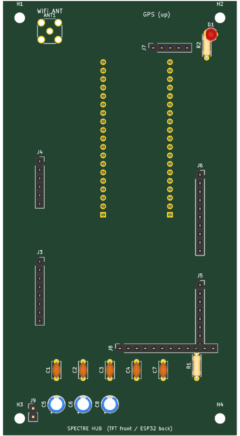
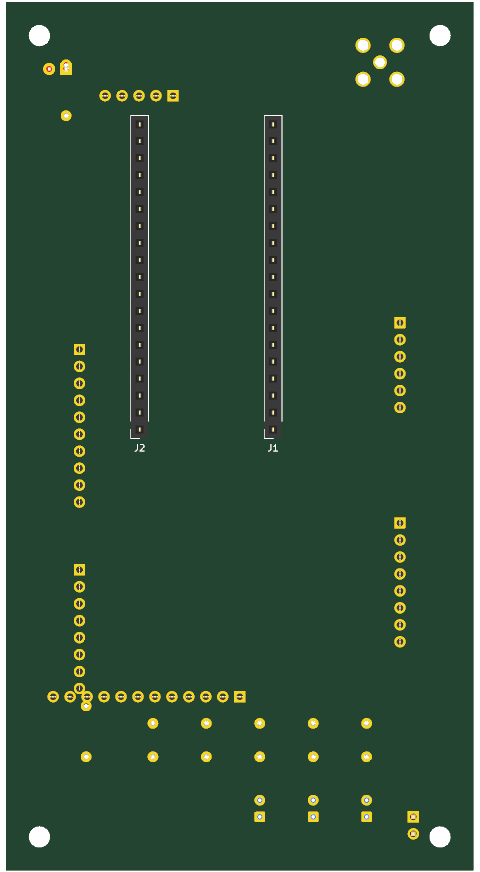

# SPECTRE HUB — KiCad carrier/baseboard PCB

A custom baseboard for the **SPECTRE HUB** so the ESP32, the 3.5" TFT shield, the GPS and
future expansion modules all **plug in / solder down** on one board instead of a wire nest.

This captures the **actual working firmware pinout** (`spectre/v1/User_Setup_SPECTRE.h` +
`spectre/v1/spectre/spectre.ino`) — ESP32-WROOM-32U + **ILI9488 8-bit PARALLEL** TFT +
NEO-7M GPS. It does **not** change the design; it just puts the existing wiring on a PCB you
can place and route.

Built and validated against **KiCad 10.0**. **ERC: 0 violations.** Netlist checked pin-by-pin.

## Files
| File | What it is |
|---|---|
| `generate_schematic.py` | The generator. Edit the pin maps and re-run (`python generate_schematic.py .`) to regenerate `spectre.kicad_sch`. |
| `spectre.kicad_sch` | The schematic: 23 symbols, all nets labelled, ready for PCB. |
| `spectre.kicad_pro` | Project file, with a **Power** netclass (1 mm tracks) on `+5V` / `+3V3` / `GND`. |
| `spectre.net` | Exported netlist (reference). |

## Board layout (done — placement + outline; routing is yours)
`spectre.kicad_pcb` already has the **outline and basic placement**. Open `spectre.kicad_pro`,
open the PCB Editor, and route — the full ratsnest is there. **`PINOUT.md`** is the human-readable
wiring map for every connector.

- **Portrait board, 70 × 130 mm** (screen is vertical → long board). 4× M3 mounting holes.
- **TFT on the FRONT:** the four UNO shield headers run vertically down both long edges
  (J3 power + J4 analog on the left, J6 + J5 digital on the right, ~48 mm apart to mate the shield).
- **ESP32 on the BACK:** J1/J2 (two 1×19 sockets) sit in the central gap, directly behind the screen.
- **Antennas at the TOP:** WiFi SMA (`ANT1`) top-left, NEO-7M GPS (`J7`) top-centre, power LED top-right.
- **Bottom:** expansion header `J8`, 5 V power in `J9`, decoupling/bulk caps.

 

Regenerate the PCB after editing placement: run
`"C:\Program Files\KiCad\10.0\bin\python.exe" generate_pcb.py` (edit the `PLACE` table first).
Note it rewrites `spectre.kicad_pcb`, so route on a copy or re-run before routing, not after.

### If you'd rather place it yourself from scratch
Delete `spectre.kicad_pcb`, open the project, PCB Editor → **Tools → Update PCB from Schematic**
(F8), then place and route. Power nets are already on 1 mm tracks via the Power netclass.

## What's on the board
| Ref | Part | Notes |
|---|---|---|
| J1 / J2 | **ESP32-WROOM-32U** DevKitC, two 1×19 sockets | The dev board sockets in. |
| J3–J6 | **TFT** as the four Arduino-UNO shield headers (1×8 / 1×6 / 1×8 / 1×10) | Your mcufriend-style ILI9488 shield plugs straight on. |
| J7 | **NEO-7M GPS**, 1×5 | VCC/GND/TXD/RXD/PPS. |
| J8 | **Expansion**, 1×12 | VSPI bus + 4 input-only lines + power (see GPIO budget). |
| J9 | **5 V power in**, 1×2 | From the 1S 18650 + boost module. |
| R1 | 10k pulldown on IO12 (TFT_D0), **DNP** | Fit only if boot/flash flakes (strapping pin). |
| R2 / D1 | Power LED | |
| C1–C8 | Decoupling | 100 nF at each VCC + 10 µF bulk on 5V/3V3. |

## ⚡ The 3.3 V logic rail (the white-screen fix, now designed in)
The shield's **3V3 pin powers the panel logic** and must be fed — supplying it is what finally
got the display working. On this board the ESP32 board's 3V3 regulator output (J1.1) runs to the
TFT power header (J3.4) and the expansion header. **Power the ESP32 from 5 V (VIN/J1.19)** so its
regulator produces that 3V3. Backlight is hardwired to VCC on the shield (no control pin — can't
be dimmed in firmware).

## ⚠️ GPIO budget — read before planning expansion
The 8-bit parallel TFT is GPIO-hungry: **13 pins** for the panel (CS/DC/RST/WR/RD + D0–D7) plus
**2** for GPS = 15 of the ESP32's usable I/O. What's left, and all that J8 exposes:

- **VSPI** — SCK=IO18, MOSI=IO23, MISO=IO19, one CS=IO5
- **4 input-only** lines — IO34, IO35, IO36, IO39 (good for IRQ / CC1101 GDO, not outputs)
- 3V3, 5V, GND

That is enough for **one SPI radio at a time** (a single CC1101 **or** one NRF24). The full
ESP32-DIV radio shield (**3× NRF24 + CC1101**) needs ~8 output control lines and **does not fit**
alongside the parallel TFT. If you want the full radio set later, the options are:
1. Fewer radios (one CC1101 or one NRF24 on J8) — fits now.
2. A second small MCU on the expansion SPI bus to own the radios (SENTINEL-style).
3. Switch SPECTRE's TFT to an **SPI** display — frees ~7 GPIOs, enough for the radios, but it's a
   different panel and a firmware change (the current parallel shield works today).

Decide this before committing a board outline, since it changes the connector count.

## ⚠️ Verify before you fab (modelled from docs, not the physical parts)
- **ESP32 pin order (most important).** J1/J2 use the canonical **DevKitC-V4** position order.
  Confirm against your actual WROOM-32U board; if a position differs, drag the net label (or edit
  the pin map in `generate_schematic.py` and re-run). IO6–IO11 are the internal flash pins — left
  unconnected on purpose; never route to them.
- **TFT shield mapping.** Modelled with the **mcufriend standard**: LCD_D0/D1 on Arduino D8/D9,
  LCD_D2–D7 on D2–D7, LCD_RD/WR/RS/CS/RST on A0–A4. Confirm your shield matches (most red 3.5"
  parallel shields do). The 1×8/1×6/1×10 socket footprints are generic 2.54 mm — swap them for an
  **Arduino-shield footprint** (or place at UNO coordinates) if you want true shield mating.
- **GPS VCC.** On +5V (the NEO-7M module regulates). If it won't get a fix on 5 V, move J7.1 to
  +3V3. **Unplug GPS TXD while flashing** only matters on boards that share USB-serial pins — here
  GPS is on IO21/IO22 (UART2), clear of the USB pins, so flashing is fine with it attached.
- **Strapping pins.** TFT uses IO12/IO2/IO15 (and expansion CS on IO5). These are boot-strapping
  pins; the shield's high-Z data lines are normally fine, but if the board won't boot/flash, fit
  R1 (10k pulldown on IO12).

## Design notes
- One parallel bus for the display (`TFT_D0..D7` + control); a separate VSPI bus for expansion.
- GPS on UART2 (IO21 RX ← GPS TXD, IO22 TX → GPS RXD), independent of the 2.4 GHz radio.
- Keep decoupling caps at the module pins when you place. Add a separate 3V3 LDO (not placed) if a
  future expansion radio browns out the dev-board regulator.
